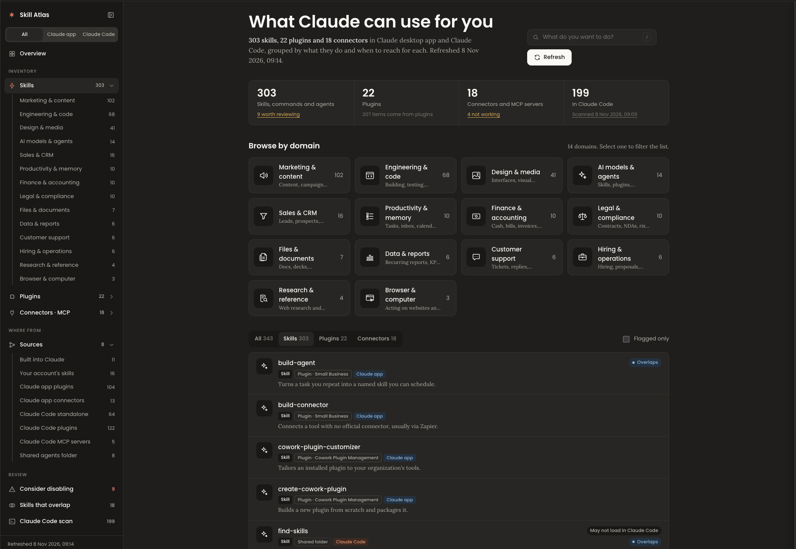

# Skill Atlas

**See everything Claude can use for you, in one page.**

Skill Atlas is a skill for Claude that builds a dashboard of every skill, plugin and MCP connector you have, in the Claude app (claude.ai, desktop, mobile) and in Claude Code. It groups them by domain, says when to use each, shows where each one came from, and flags duplicates, overlaps and broken connectors.



## Why

Once you install a few plugins, you can have hundreds of skills. Settings shows them one at a time, and the `/` menu shows a name and half a line. You end up not knowing what you have, which skill to ask for, or why Claude picked the wrong one.

Skill Atlas answers four questions:

1. **What do I have?** Every skill, command, subagent, plugin and connector, by domain: Marketing, Engineering, Design, Finance and ten more.
2. **When do I use which?** A plain one-line summary, example phrases that trigger it, and the `/command` to call it directly.
3. **Where did it come from?** Built in, uploaded by you, part of a plugin (with its author and marketplace), or a standalone file, with an honest confidence label: Confirmed, Matched by name, Inferred or Unknown.
4. **What should I clean up?** Skills installed twice, skills that overlap, skills built for a country or tool you don't use, and connectors that need reconnecting.

Claude reads the description of every enabled skill at the start of each conversation. Fewer, clearer skills mean fewer wrong picks.

## Install

### Claude app (claude.ai, desktop)

Add this repository as a plugin marketplace, then install from it. No downloads, and updates come straight from GitHub.

1. Open **Customize → Plugins**, click **Add**, then **Add marketplace → Add from a repository**.
2. Enter `leonard-abusaa/skill-atlas`.
3. Install **Skill Atlas** from the new marketplace.
4. Open a new chat and say **"Refresh my Skill Atlas"**. You can also call it directly as `/skill-atlas:skill-atlas`.

A plugin you add in the Claude app also loads in Claude Code when you're signed in to the same account, so one install covers both.

Prefer a single skill instead? Download [`dist/skill-atlas.zip`](dist/skill-atlas.zip) and upload it under **Customize → Skills → + → Create skill → Upload a skill**. Custom skills need **Settings → Capabilities → Code execution and file creation** turned on.

### Claude Code

As a plugin:

```
/plugin install skill-atlas --marketplace leonard-abusaa/skill-atlas
```

or, on older versions:

```
claude plugin marketplace add leonard-abusaa/skill-atlas
claude plugin install skill-atlas@skill-atlas
```

The plugin's command is `/skill-atlas:skill-atlas`.

Or as a standalone skill, which gives you `/skill-atlas`:

```
git clone https://github.com/leonard-abusaa/skill-atlas
mkdir -p ~/.claude/skills
cp -R skill-atlas/plugins/skill-atlas/skills/skill-atlas ~/.claude/skills/
```

Start a new Claude Code session after installing.

## Update

- **Claude Code:** `claude plugin update skill-atlas@skill-atlas`. New versions install when the plugin's version number changes.
- **Claude app:** plugins from a marketplace you added follow the repository. If a new version doesn't show up, remove and add the plugin again under **Customize → Plugins**.

## Use

**In the Claude app**, say:

> Refresh my Skill Atlas

Claude lists your skills, plugins and connectors, writes the summaries and checks, and publishes the dashboard as a private artifact. Running it again updates the same link and lists what changed.

**To include Claude Code**, the Claude app can't see your computer's Claude Code folders, so there's one extra step:

1. In Claude Code, from a project folder, run `/skill-atlas:skill-atlas collect` (or `/skill-atlas collect` if you installed it as a standalone skill). It writes `~/claude-code-inventory.json`.
2. In the Claude app, attach that file and say "Refresh my Skill Atlas".

You can also build the dashboard entirely inside Claude Code. Where Claude Code can't publish artifacts, it saves `skill-atlas.html` in your home folder and opens it in your browser.

The **Refresh** button on the dashboard copies the prompt. Paste it into any Claude chat.

## Privacy

The Claude Code collector (`scripts/collect_claude_code.py`):

- is **read-only** and makes **no network calls**;
- reads only names and descriptions from the top of skill, command and agent files, plus plugin and MCP configuration;
- for MCP servers keeps only the name, the transport type and the command name or host, and ignores every other key in `~/.claude.json`, including account details;
- **never** keeps environment variables, headers, arguments, API keys, tokens, passwords or full URLs. Git remotes are stripped of any credentials;
- writes one JSON file you can read before sharing it.

The dashboard is published as a private artifact in your own Claude account. Nobody else can open it unless you share it. When you open it, your browser loads the Poppins and Lora fonts from Google Fonts; that is the only outside request, and it carries no data from your setup.

## How it works

```
plugins/skill-atlas/skills/skill-atlas/
  SKILL.md                         instructions Claude follows (collect and build modes)
  assets/template.html             the dashboard; the same for every user
  assets/categories.json           the 14 fixed domains
  scripts/collect_claude_code.py   read-only Claude Code scanner
  scripts/render.py                validates the data and fills the template
  reference/schema.md              the data format Claude writes
```

Claude gathers the inventory, writes `atlas-data.json` following `reference/schema.md`, and `render.py` validates it and injects it into the template. The template never changes per user, so the page looks the same for everyone and Claude doesn't spend effort redesigning it.

On a refresh, Claude reuses the summaries and categories it wrote last time for anything unchanged, so refreshes are much cheaper than the first build.

## Limits

- **Claude Code needs the collect step.** The Claude app has no access to the folders on your computer.
- **MCP server status in Claude Code isn't checked.** Run `/mcp` in Claude Code to see which servers are connected.
- **Origins of standalone files can be uncertain.** Files copied into `~/.claude` by hand don't record where they came from. The collector records symlinks, git remotes, install dates and installer lock files when they exist, and the dashboard labels anything else as Inferred or Unknown.
- **Skills only in `~/.agents/skills`** are shown, but marked "May not load in Claude Code".
- **Summaries are written by Claude** on each build. Treat them as a guide; the original description is always one click away.

## Development

Rebuild the upload zip after changing the skill:

```
./scripts/package.sh
```

Validate the plugin and marketplace:

```
claude plugin validate .
```

## License

MIT. See [LICENSE](LICENSE).

Not affiliated with Anthropic. Claude is a trademark of Anthropic.
