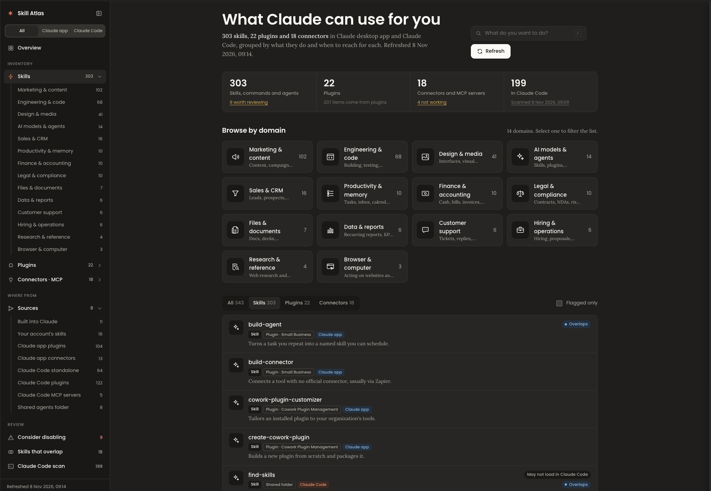

# Skill Atlas

Skill Atlas builds a private dashboard of everything Claude can use for you: every skill, slash command, subagent, plugin and MCP connector in the Claude app and in Claude Code, grouped into 14 domains such as Marketing, Engineering, Design and Finance.

For each item it shows a plain one-line summary, example phrases that trigger it, the command to call it directly, and where it came from: built into Claude, uploaded by you, part of a plugin (with author and marketplace), or a standalone file, each with a confidence label. It also flags skills installed twice, skills that overlap, skills built for a country or tool you may not use, and connectors that need reconnecting. The dashboard only suggests; it never disables, uninstalls or reconnects anything.

## Use

- In the Claude app, say **"Refresh my Skill Atlas"**. Claude lists your skills, plugins and connectors with its built-in listing tools, writes the dashboard data, and publishes it as a private artifact in your account. Running it again updates the same link and shows what changed.
- In Claude Code, run **`/skill-atlas:skill-atlas collect`** to scan your local setup into `~/claude-code-inventory.json`, then attach that file in a Claude app chat and say "Refresh my Skill Atlas" to see both in one dashboard.

## What it runs, reads and sends

- `scripts/collect_claude_code.py` (Claude Code only, when you ask for "collect"): read-only, no network calls. It reads the name and description at the top of skill, command and agent files in `~/.claude`, `~/.agents/skills` and the current project's `.claude/` folder; installed plugin manifests; and the `mcpServers` entries in `~/.claude.json` and `.mcp.json`, from which it keeps only each server's name, transport type and command name or host. It never keeps environment variables, headers, arguments, tokens, passwords or full URLs, and strips credentials from git remotes. It writes one JSON file in your home folder.
- `scripts/render.py`: validates the dashboard data and fills `assets/template.html`. No network calls.
- The dashboard is published as a private artifact in your own Claude account. Nothing is sent anywhere else.

## License

MIT. Not affiliated with Anthropic.
